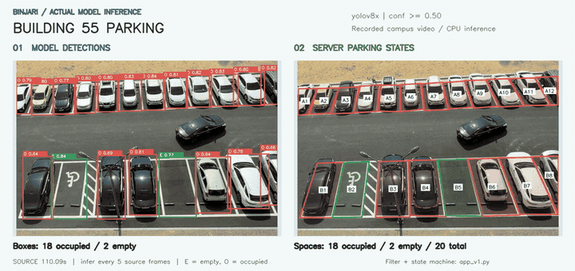
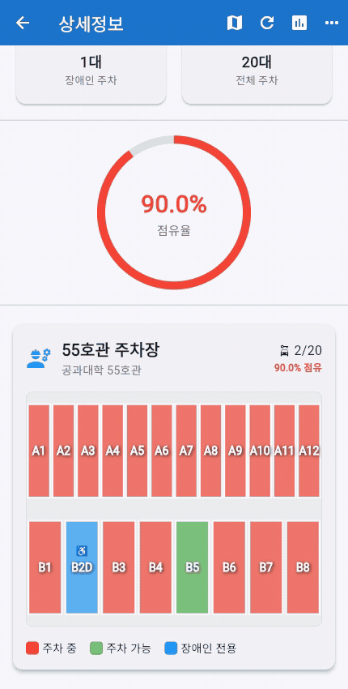

# BINJARI | 빈자리

주차장 영상에서 주차면별 점유 상태를 분석하고, 운전자에게 빈자리와 시간대별 혼잡도를 보여주는 스마트 주차장 모니터링 서비스입니다. 창원대학교 컴퓨터공학과 캡스톤 디자인 프로젝트로, 55호관과 도서관 주차장 **2곳의 주차면 56개**를 대상으로 구현했습니다.


## 프로젝트 문서

| 문서 | 확인할 내용 |
| --- | --- |
| [요구사항 명세](docs/REQUIREMENTS.md) | 운전자와 관리자 기능, 처리 규칙, 구현 근거 |
| [API 명세](docs/API.md) | 엔드포인트, 인증, 요청, 응답 필드, 오류 코드와 호출 예시 |
| [모델, 추론 재현](docs/MODEL.md) | 학습 체크포인트, 저장된 검증 지표, 실제 영상 시연과 재실행 방법 |
| [시스템 아키텍처](#시스템-아키텍처) | 영상 입력부터 분석, 저장, 앱 조회까지의 데이터 흐름 |

## 실제 주차장 영상 분석

[](docs/demo/b5-transition.mp4)

직접 촬영한 55호관 영상에 **학습된 YOLOv8x**와 현재 Flask 판정 코드를 실행했습니다. 왼쪽에는 모델이 찾은 빈자리와 점유 영역을 박스로 표시했습니다. 오른쪽은 그 결과를 미리 정한 주차면 다각형에 연결하고 시간 필터를 거친 상태입니다. 빨간색은 점유, 초록색은 빈자리입니다. 녹화 영상의 일부 구간을 다시 분석한 결과입니다.

[55호관 20면 MP4](docs/demo/building55-inference.mp4), [도서관 36면 MP4](docs/demo/library-inference.mp4), [모델 정보와 프레임별 실행 기록](docs/MODEL.md)

### B5 입차와 앱 상세 화면의 상태 변화

`parking_best.mp4`의 **01:50–02:20** 구간을 원래 속도로 재생합니다. 실제 모델과 서버 판정 코드에서 B5가 **02:08.52에 빈자리에서 점유로 전환**됐습니다.

| 영상 분석 (30초) | 실제 Flutter 상세 화면 (30초) |
| :---: | :---: |
| [](docs/demo/b5-transition.mp4) | [](docs/demo/detail-transition.mp4) |
| 왼쪽은 탐지 결과, 오른쪽은 시간 필터와 상태 전이를 거친 주차면 상태입니다. | B5가 초록에서 빨강으로 바뀌고 빈자리는 2→1, 점유율은 90→95%로 바뀝니다. |

앱 영상은 기존 Flutter 웹 빌드의 상세 화면에 **같은 실제 추론 결과를 API로 시간 순서대로 재생**해 녹화했습니다. 앱이 실제 추론 결과를 받아 색상을 바꿉니다. 기존 10초 조회 주기를 유지했으므로 모델이 판정한 뒤 앱이 다음 데이터를 받아올 때 화면도 바뀝니다. 녹화 원본을 이용한 재생 시연이며 운영 중인 CCTV 중계나 실시간 성능 측정 영상은 아닙니다.

GIF는 README에서 반복 재생됩니다. [영상 분석 MP4, 30초](docs/demo/b5-transition.mp4), [앱 상세 화면 MP4, 30초](docs/demo/detail-transition.mp4)에서 재생 위치와 화질을 직접 확인할 수 있습니다.

[추론 프레임별 기록](docs/demo/b5-transition.json), [앱 조회 기록](docs/demo/detail-transition-log.json), [로컬 재생 서버](scripts/serve_inference_replay.py)

## 주요 기능과 실행 화면

- **주차 현황:** 캠퍼스 지도에서 주차장을 선택하고 전체, 점유, 빈 주차면 수를 확인합니다.
- **주차면별 상태:** 영상 분석 결과를 주차면 다각형에 연결해 점유 상태와 빈자리 상태를 표시합니다.
- **시간대별 통계:** 저장된 점유율을 24개 시간 구간으로 집계하고, 기록이 있는 향후 12시간 중 상대적으로 여유로운 시간을 안내합니다.
- **운영 관리:** 관리자 화면에서 영상 소스, 주차면 좌표, 분석 서버 실행 상태를 관리합니다.

| 캠퍼스 지도 | 주차장 선택 |
| --- | --- |
|  |  |
| 주차장 위치를 탐색합니다. | 빈자리 수와 점유율을 확인합니다. |

| 주차장 상세 | 주차면별 상태 |
| --- | --- |
|  |  |
| 전체, 사용 중, 주차 가능 면수를 확인합니다. | 각 주차면의 상태를 색상으로 구분합니다. |

| 시간대별 점유율 | 통계 요약 |
| --- | --- |
|  |  |
| 시간대별 점유율을 그래프로 살펴봅니다. | 현재 상태와 최근 기록을 함께 확인합니다. |

## 시스템 아키텍처


분석 서버가 영상을 읽고 YOLOv8x로 빈자리와 점유 상태를 찾습니다. 이 계산을 추론이라고 합니다. 탐지 결과를 각 주차면에 연결해 상태를 판정하고 기록을 저장합니다. Flutter 앱은 서버 API에서 현재 상태와 통계를 받아 보여줍니다.

영상 파일로도 실행할 수 있습니다. 분석할 영상과 주차면 좌표는 관리자 기능에서 설정합니다.

## 기술 스택과 선택 이유

<table>
  <tr>
    <td width="33%" valign="top"><br><strong>운전자와 관리자 앱</strong><br>지도, 주차 현황, 통계, 관리 화면을 하나의 코드베이스로 구성했습니다. Android, iOS, Web 화면을 같은 데이터 모델과 API로 연결할 수 있습니다.</td>
    <td width="33%" valign="top"><br><strong>분석 API</strong><br>Python 영상 처리 로직을 앱과 분리하고, 주차 상태와 통계, 관리 기능을 REST API로 제공하기 위해 사용했습니다.</td>
    <td width="33%" valign="top"><br><strong>주차면 탐지</strong><br><code>space-empty</code>, <code>space-occupied</code>로 학습한 YOLOv8x를 사용합니다. 저장된 검증 지표와 실제 영상 실행 결과를 함께 확인할 수 있습니다.</td>
  </tr>
  <tr>
    <td valign="top"><br><strong>영상과 공간 처리</strong><br>영상 프레임을 읽고, 탐지 박스와 주차면 다각형의 마스크 교차 영역을 계산하는 데 사용했습니다.</td>
    <td valign="top"><br><strong>상태와 이력 저장</strong><br>단일 분석 서버에서 주차면 상태, 입출차 이력, 점유율 샘플을 별도 DB 서버 없이 관리합니다.</td>
    <td valign="top"><br><strong>위치 중심 탐색</strong><br>사용자가 캠퍼스 지도에서 주차장 위치와 현황을 함께 파악하도록 구성했습니다. 점유율 그래프에는 <code>fl_chart</code>를 사용합니다.</td>
  </tr>
</table>

<a id="담당-역할-및-핵심-구현"></a>
## 제가 맡은 역할

저는 **Flask 백엔드 개발, 영상 추론 주기 조정, 주차 상태 판정, SQLite 데이터 저장과 통계 처리**를 담당했습니다. Flutter 사용자 앱과 관리자 화면을 포함한 서비스 전체는 팀이 함께 만들었습니다.

| 구현 | 접근 방식 | 코드 |
| --- | --- | --- |
| 영상 처리와 상태 API | 주차장별 영상 프레임을 처리하고 추론 결과를 주차면 상태로 변환 | [`ParkingSystem`](app_v1.py#L490-L715), [`_detect_vehicles`](app_v1.py#L854-L1083) |
| 공간 매핑 | 주차면 다각형과 탐지 박스의 교차 면적을 구해 `겹침 비율 × 탐지 신뢰도`로 점수화 | [`_calculate_mappings`](app_v1.py#L1132-L1155) |
| 상태 안정화 | 최근 판정의 시간 가중 평균을 구하고, 점유와 빈자리 전환에 서로 다른 기준을 적용 | [`TemporalFilter`, `ParkingSpaceStateMachine`](app_v1.py#L1225-L1405) |
| 통계와 추천 | 점유율 샘플을 시간대별로 집계하고 관측 데이터가 있는 시간대만 추천 후보로 사용 | [`build_statistics`](app_v1.py#L1602-L1689) |

<a id="troubleshooting"></a>
## 개발 중 해결한 문제

### 1. 영상의 모든 프레임을 분석하느라 정보 반영이 늦었습니다

**문제와 원인:** 연속된 영상 프레임은 대부분 비슷한 주차 상태를 담고 있습니다. 모든 프레임에 모델을 실행하다 보니 상태가 그대로인 장면에도 같은 계산을 반복했습니다.

**해결:** 프레임 카운터를 두고 **5프레임당 1회**만 추론하도록 변경했습니다. 추론하지 않는 프레임은 모델 실행을 건너뛰고, 상태 판정은 추론이 실행된 프레임에서만 갱신합니다. [프레임 스킵 코드](app_v1.py#L695-L704)

| 항목 | 모든 프레임을 추론할 경우 | 현재 설정 |
| --- | --- | --- |
| 추론 주기 | 매 프레임 | 5프레임당 1회 |
| 추론 대상 프레임 수 | 100% | 약 20% |

추론 대상 프레임 수를 약 80% 줄이는 설정입니다. 이번 시연에서도 같은 간격으로 모델을 실행했으며, 원본 프레임 번호와 실제 추론 결과를 [실행 기록](docs/MODEL.md)에 남겼습니다. 영상 디코딩 등을 포함한 전체 연산량 감소율을 뜻하지는 않습니다.

### 2. 차량을 잠깐 놓쳐도 빈자리로 안내할 수 있었습니다

**문제와 원인:** 차량이 가려지거나 탐지 신뢰도가 일시적으로 낮아질 때 단일 프레임 결과로 상태를 바꾸면, 주차된 면을 빈자리로 잘못 안내할 수 있습니다.

**해결:** 일반 주차면은 최근 **10개 판정**에 탐지 신뢰도와 시간 감쇠 가중치(`0.9`)를 적용합니다. 점유 임계값 `0.7`로 필터 결과를 구분한 뒤, 상태 머신에서 상태를 바꿀지 결정합니다. 빈자리에서 점유로 바꿀 때는 **5회**, 점유에서 빈자리로 바꿀 때는 **8회** 확인합니다. 반대 판정이 나오면 해당 방향의 카운터를 초기화하고, 신뢰도 `0.7` 미만이면 카운터를 갱신하지 않습니다. 이 횟수는 원본 영상이 아닌 **추론을 수행한 프레임 기준**입니다. [시간 필터, 상태 머신](app_v1.py#L1225-L1405)

카메라 가장자리에 걸리는 55호관 B1은 별도 필터와 더 엄격한 빈자리 확인 조건을 적용했습니다. 빈자리를 잘못 안내하는 오류를 줄이는 대신, 실제 출차 직후의 반영은 늦어질 수 있습니다. [B1 예외 처리](app_v1.py#L990-L1060)

### 3. 현재 빈자리 수만으로는 방문 시간을 고르기 어려웠습니다

**문제:** 현재 상태만 알려주면 사용자가 방문하려는 시간에는 얼마나 붐빌지 비교하기 어려웠습니다.

**해결:** 점유율을 **5분 간격**으로 SQLite에 저장하고 24개 시간 구간으로 집계했습니다. 현재 시간은 실시간 분석값을, 나머지 시간은 **당일 평균 → 최근 7일 평균** 순으로 사용합니다. 향후 12시간 중 기록이 있는 시간대에서 점유율이 가장 낮은 시간을 추천합니다. 기록이 없으면 `has_data=false`로 표시하고 추천에서 제외합니다. 추천에는 별도의 AI 예측 모델을 쓰지 않고 **관측 기록을 비교**합니다. [점유율 기록](app_v1.py#L1074-L1082), [집계와 추천](app_v1.py#L1602-L1689)

### 4. 주차장이 달라도 같은 주차면 ID가 쓰였습니다

**문제와 원인:** 55호관과 도서관 모두 `A1`, `B1` 같은 주차면 ID를 사용합니다. 초기 스키마처럼 ID만 기본키로 사용하면 서로 다른 주차장의 상태를 구분할 수 없습니다.

**해결:** 현재 상태 테이블의 기본키를 **`(parking_lot, id)`**로 바꿨습니다. 주차장과 주차면 ID를 함께 써서 구분하고, 상태 조회와 입출차 이력 갱신에도 두 값을 사용합니다. 기존 스키마로 생성된 상태 캐시는 초기화 시 새 스키마로 재생성합니다. [DB 스키마](app_v1.py#L335-L374), [상태와 이력 갱신](app_v1.py#L1172-L1217)

## 구현 결과

- 2개 주차장, **56개 주차면**을 대상으로 상태 조회 구조 구현
- 5프레임당 1회 추론으로 **추론 대상 프레임 수 약 80% 감소**
- 학습된 YOLOv8x로 두 주차장 원본 영상을 재실행하고, 탐지 결과와 주차면 상태를 나란히 보여주는 시연과 프레임별 결과 공개
- 시간 가중 필터를 적용하고 점유와 빈자리 전환의 확인 횟수를 다르게 설정해, 순간적인 탐지 누락이 곧바로 빈자리 안내에 반영되지 않도록 설계
- SQLite 기록을 활용한 시간대별 점유율 조회와 방문 시간 추천 구현
- 교내 소프트웨어 전시회 **인기상** 수상

## 실행 방법

### 분석 서버

```bash
python -m venv .venv
source .venv/bin/activate
pip install -r requirements.txt

export MODEL_PATH="$PWD/models/best_seo.pt"
export ADMIN_TOKEN="change-me"
python app_v1.py --no-video
```

기본 포트는 `5000`입니다. 실제 시연에 사용한 가중치는 `best_seo.pt`이며 파일 식별 정보와 환경은 [모델, 추론 재현 문서](docs/MODEL.md)에 정리했습니다. 원본 가중치는 Git 저장소에 포함하지 않으므로 `models/best_seo.pt`에 두거나 `MODEL_PATH`로 지정합니다. 도서관 입력 영상은 [`videos/library2.mp4`](videos/library2.mp4)에 있으며, 다른 영상 경로는 `VIDEO_PATH_A`, `VIDEO_PATH_B`로 지정할 수 있습니다.

### Flutter 앱

```bash
flutter pub get
flutter run --dart-define=API_BASE_URL=http://<서버 IP>:5000
```

Google Maps API 키는 Android에서 `android/local.properties`의 `MAPS_API_KEY`, iOS에서 `ios/Flutter/Secrets.xcconfig`의 `MAPS_API_KEY`로 설정합니다. 실제 기기에서 서버에 연결할 때는 `localhost` 대신 서버의 LAN IP를 사용합니다.

## 프로젝트 정보

창원대학교 컴퓨터공학과 캡스톤 디자인, 모진성, 안서현
