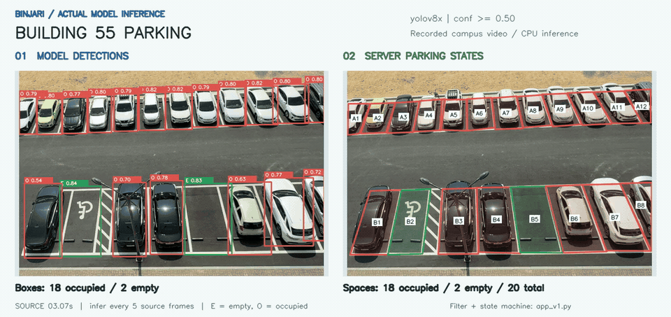
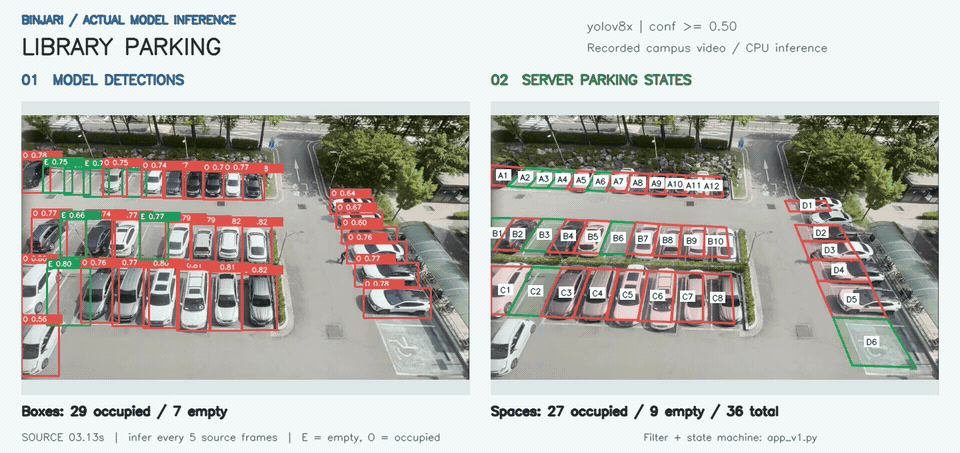
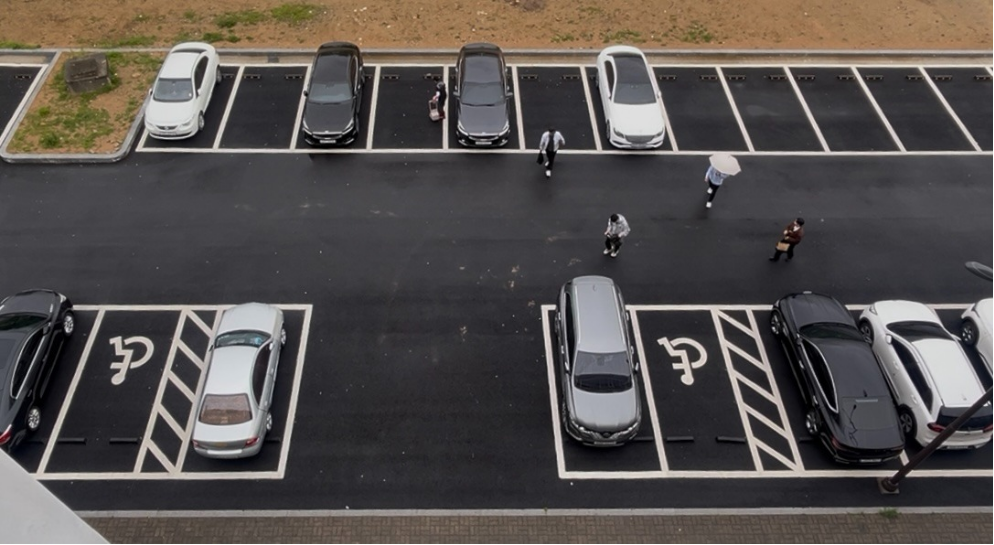
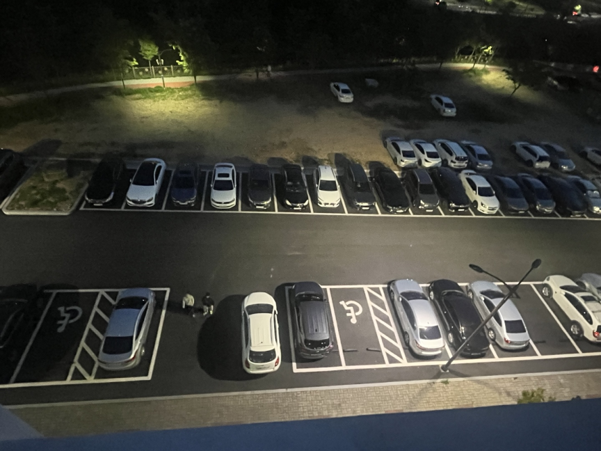

# 모델과 실제 영상 추론

프로젝트에 보관된 학습 가중치와 원본 주차장 영상을 사용해 분석 코드를 재실행했습니다. 시연은 YOLO가 반환한 탐지 결과를 `app_v1.py`의 공간 매핑·시간 필터·상태 머신에 전달해 생성했습니다.

## 시연 영상

### B5 입차와 실제 앱 상태 전환

[](demo/b5-transition.mp4)

- 원본: `parking_best.mp4`의 110–140초, 30초, 원래 속도.
- 실제 판정: B5는 110.0023초에 빈자리였고 128.5195초에 점유로 전환됐습니다. 모델·임계값·주차면 좌표를 시연을 위해 바꾸지 않았습니다.
- 이 구간의 최초·최종 판정을 비교하면 바뀐 주차면은 B5 하나이며, 빈자리 수는 2개에서 1개로 바뀝니다.
- [실제 Flutter 상세 화면 녹화](demo/detail-transition.mp4): 기존 웹 빌드에 같은 추론 결과를 로컬 API로 재생했습니다. 상세 화면의 10초 자동 조회 주기를 유지했습니다.
- 로컬 상태 API는 재생 시작 후 20.489초의 조회부터 점유 결과를 반환했습니다. 상세 화면은 자신의 다음 조회(25.730초) 이후 갱신합니다. 지도 화면도 뒤에서 조회하므로 조회 기록 전체의 첫 점유 응답과 상세 화면의 갱신 시각은 다릅니다. 모델 전환 시각, API 조회 시각, 화면 반영 시각을 구분합니다.

[프레임별 실제 결과](demo/b5-transition.json) · [앱 조회 기록](demo/detail-transition-log.json)

README의 반복 미리보기는 동일한 MP4에서 만든 GIF입니다. 영상 분석은 가로 720px·4 FPS·최대 64색, 앱 상세 화면은 가로 430px·5 FPS·최대 64색입니다. 두 미리보기 모두 30초를 유지했으며 상태 전환을 수동으로 추가하지 않았습니다. 고화질 재생과 탐색은 연결된 MP4를 사용합니다.

재실행:

```bash
python scripts/create_inference_demo.py \
  --model models/best_seo.pt --video /path/to/parking_best.mp4 \
  --lot parking_lot_A --output docs/demo/b5-transition \
  --start 110 --duration 30

# 기존 Flutter 웹 빌드를 build/web에 준비한 뒤 실행
python scripts/serve_inference_replay.py \
  --report docs/demo/b5-transition.json --web-root build/web --port 8766
```

재생 서버의 `POST /replay/start`로 시간 재생을 시작하고, Flutter 앱이 조회하는 `/api/status`를 이 로컬 서버로 연결합니다. 녹화에서는 브라우저 요청 프록시를 사용해 기존 API 주소의 상태 조회만 로컬로 전달했습니다. 앱의 화면 구현·자동 조회 주기와 운영 데이터는 변경하지 않았습니다. 이 서버는 기록을 재생할 뿐 모델을 새로 실행하거나 상태를 생성하지 않으며, 실제 CCTV 운영 서버를 대신하지 않습니다.

### 55호관 · 주차면 20개

[](demo/building55-inference.mp4)

왼쪽은 모델의 탐지 박스와 신뢰도, 오른쪽은 주차면별 서버 판정입니다. 빨간색은 점유, 초록색은 빈자리입니다. [MP4](demo/building55-inference.mp4) · [프레임별 결과 JSON](demo/building55-inference.json)

### 도서관 · 주차면 36개

[](demo/library-inference.mp4)

탐지 박스 수와 주차면 수는 다를 수 있습니다. 서버는 지정된 다각형과 겹치는 결과를 매핑하고, 최근 판정 이력까지 반영해 상태를 결정합니다. [MP4](demo/library-inference.mp4) · [프레임별 결과 JSON](demo/library-inference.json)

## 사용한 모델

시연과 기존 운영 로그에서 확인한 모델은 **`best_seo.pt`(YOLOv8x)** 입니다. 두 체크포인트 모두 `0: space-empty`, `1: space-occupied`를 사용하며 Ultralytics `8.3.65`로 저장됐습니다.

| 체크포인트 | 학습 기반 모델 | Precision | Recall | mAP@50 | mAP@50:95 |
| --- | --- | ---: | ---: | ---: | ---: |
| **best_seo.pt** | **YOLOv8x** | **95.02%** | **95.10%** | **97.42%** | **84.91%** |
| best_seo2.pt | YOLOv5x | 91.57% | 87.90% | 92.75% | 81.42% |

수치는 각 파일에 저장된 **학습 당시 검증 지표**입니다. 학습 설정이 다른 두 실험의 기록이며, 이번 영상의 정확도나 주차면 상태 판정 정확도를 새로 측정한 결과는 아닙니다. 재평가용 정답 라벨과 데이터 분할 정보는 현재 보관 자료에서 확인되지 않았습니다.

YOLOv8x 체크포인트의 저장 설정은 입력 크기 `640`, 최대 `200 epochs`, `batch=16`, `patience=20`입니다. 두 모델 중 실제 시연에는 운영 코드와 로그에서 사용이 확인된 YOLOv8x를 적용했습니다.

| 파일 식별 정보 | 값 |
| --- | --- |
| `best_seo.pt` 크기 | 136,737,651 bytes |
| 저장 일시 | 2025-04-03T17:53:41.410841 |
| SHA-256 | `b4e206a24df2d28bf39853a33e35d0b170f3b2e383a3bb620282ee53dbffe756` |
| `best_seo2.pt` SHA-256 | `80e1e9e1c7d686665546f0828fb3e1530a80cde7937a151b8f5d438549974f68` |

원본 가중치는 Git 추적 대상에서 제외했습니다. 재실행할 때 해당 파일을 `models/best_seo.pt`에 두거나 모델 경로를 직접 지정합니다.

## 현장 데이터 수집

팀은 55호관과 도서관에서 시간대·조명 조건을 달리해 영상을 수집했습니다. 아래는 프로젝트 발표 자료에 포함된 주간·야간 촬영 사진입니다.

| 주간 촬영 | 야간 촬영 |
| --- | --- |
|  |  |

자료에는 공개 차량 이미지 약 400장을 초기 데이터로 사용하고, 빈 주차면을 추가 라벨링한 과정이 기록돼 있습니다. 현재 공개 시연은 보관된 **주간 영상 두 개**를 사용했습니다.

## 재실행 방법

Python 3.12, PyTorch 2.5.1, Ultralytics 8.3.65, OpenCV 4.11.0 환경에서 CPU로 실행했습니다.

```bash
pip install -r requirements-demo.txt

python scripts/create_inference_demo.py \
  --model models/best_seo.pt \
  --video videos/library2.mp4 \
  --lot parking_lot_B \
  --output docs/demo/library-inference \
  --start 3 --duration 8

python scripts/create_inference_demo.py \
  --model models/best_seo.pt \
  --video /path/to/parking_best.mp4 \
  --lot parking_lot_A \
  --output docs/demo/building55-inference \
  --start 3 --duration 8
```

[`create_inference_demo.py`](../scripts/create_inference_demo.py)는 현재 서버의 `_detect_vehicles`를 호출합니다. 별도의 임시 DB를 사용하므로 운영 이력에 시연 기록을 섞지 않습니다. 기본 설정은 신뢰도 `0.5`, 5프레임당 1회 추론이며 출력 시작 전 3초 분량으로 필터를 예열합니다.

| 입력 | 해상도 | 원본 FPS | 시연 길이 | 시연의 추론 프레임 수 |
| --- | --- | ---: | ---: | ---: |
| `parking_best.mp4` | 970 × 652 | 약 59.94 | 약 8초 | 96 |
| `library2.mp4` | 1216 × 720 | 30 | 8초 | 48 |

각 실행은 MP4·GIF·미리보기 JPG·JSON을 생성합니다. JSON에는 모델·입력 영상의 SHA-256, 실행 환경, 샘플링 설정, 프레임별 실제 탐지 박스와 주차면 상태가 포함됩니다. 원본 영상 시간에 맞춰 재생하는 녹화본이며, 영상의 재생 속도나 JSON의 모델 호출 시간은 앱 전체의 응답 지연 측정값과는 별개입니다.
